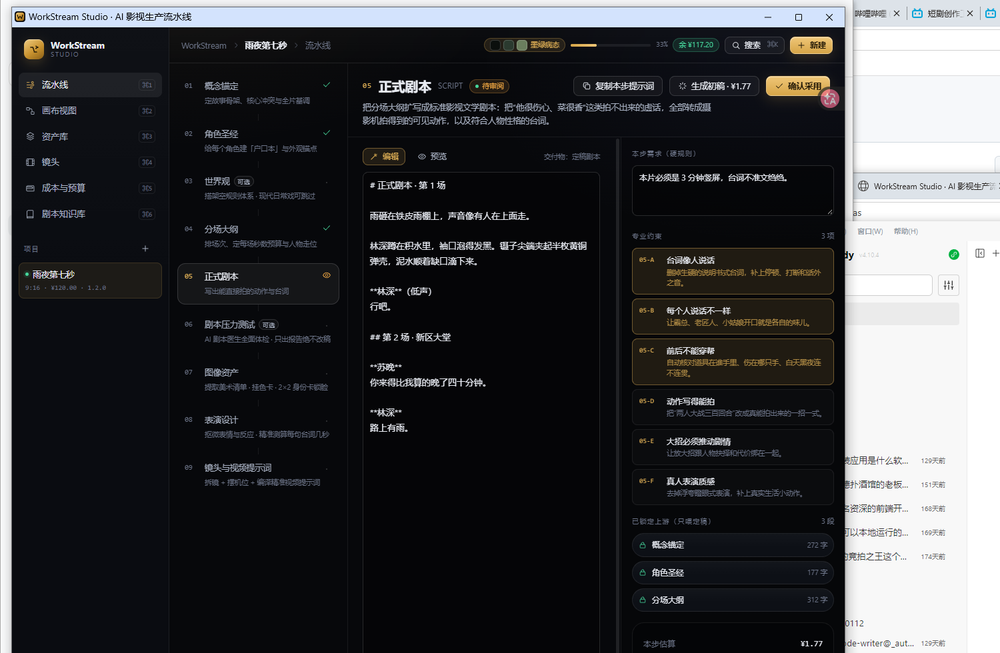
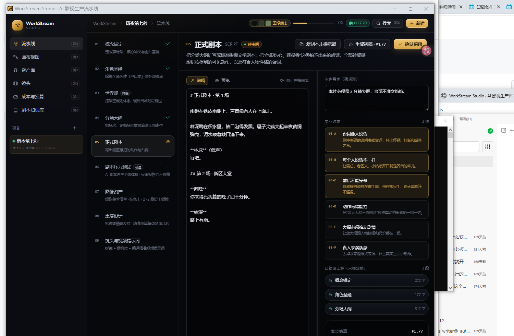

<div align="center">

# WorkStream Studio

**AI 影视生产流水线 · 一个人的电影剧组**

九阶段上下文隔离 · 三级锁定 · 人工闸口 · 成本可控 · 一致性锚点

`Web` · `Windows` · `macOS`

</div>

---



<p align="center"><sub>九阶段工作台：左阶段导航 · 中编辑区 · 右「本步需求 + 专业约束 + 已锁定上游 + 成本」</sub></p>



<p align="center"><sub>Windows 客户端实拍（Electron 外壳，与网页版同一构建）</sub></p>

---

## 这是什么

WorkStream Studio 把「拍一部片子」拆成九个互不污染的阶段（概念锚定 → 镜头提示词），
每个阶段独立存档，**只有你点下「确认采用」，这一步的稿子才会变成下游不可篡改的铁律**。
中间卡两道人工闸口（G1 剧本定稿 / G2 成片终审）和一道预算闸口，超支自动挂起。

它不是又一个聊天框，也不是又一个生图网站，而是**把导演方法论做成了软件流程**。

### 解决的四个真实问题

| 痛点 | 传统做法 | WorkStream 的解法 |
|---|---|---|
| **上下文串戏** | 所有事在一个对话框里聊，几十轮后 AI 忘了设定、擅自改结局 | 九阶段隔离，每阶段只喂「已锁定的上游定稿」 |
| **人物变脸穿帮** | 写一百遍"保持人物一致" | 2×2 四视图身份卡 + 场景多角度 + LIRA 色卡，一致性做成结构化资产 |
| **台词与镜头打架** | 5 秒视频塞 20 秒台词 | 表演阶段按语速算秒数，超时长直接标红并建议拆镜 |
| **预算失控** | 生成完才知道花了多少 | 生成前显示预估，超支挂起，追加预算需人工审批 |

---

## 功能

| 模块 | 能力 |
|---|---|
| **流水线** | 九阶段工作台：本步需求、71 项专业约束、已锁定上游上下文、成本预估、版本历史、锁稿 / 解锁 / 跳过 |
| **画布视图** | DAG 形式的流水线：阶段是节点、闸口是边，未过闸口下游不推进 |
| **资产库** | 角色 / 场景 / 道具 / 风格四类，2×2 四视图槽位、版本栈、定稿锁；24 套 LIRA 导演色卡 |
| **镜头** | 场次表主视图：景别、运镜、秒数、台词秒数校验、逐镜重做（不覆盖旧结果）、编译后的视频提示词 |
| **交付** | 时间线排布（首尾相接 + 时间码）、6 项交付自检、导出交付清单 MD / 镜头表 CSV / **EDL 时间线**（导入达芬奇·PR） |
| **成本** | 预算进度、80%/100% 双档、闸口、消费明细、CSV 导出 |
| **知识库** | 挂载本地编剧方法书与参考剧本（.md/.txt），中文双字 + TF-IDF 本地检索，命中片段自动注入提示词 |
| **命令面板** | `⌘K` / `Ctrl+K` 全局搜索阶段、动作、项目 |

### 快捷键

| 键 | 作用 |
|---|---|
| `⌘K` / `Ctrl+K` | 命令面板 |
| `⌘1`–`⌘7` | 切换视图（流水线 / 画布 / 资产 / 镜头 / 交付 / 成本 / 知识库） |
| `Esc` | 关闭浮层 |

---

## 快速开始

### 网页版

```bash
npm install
npm run dev          # http://127.0.0.1:5180
npm run build        # 产出 dist/
npm run preview      # 预览构建产物
```

### 桌面版

```bash
cd desktop
npm install
npm start            # 需要先跑 npm run dev（WORKSTREAM_DEV_URL 指向 4173）

# 打包
npm run build:win    # Windows：NSIS 安装包 + 免安装版
npm run build:mac    # macOS：dmg（需在 macOS 上执行，或走 CI）
```

### 测试

```bash
npm run test         # vitest：32 用例（预算闸口 / 台词读秒 / 上下文隔离 / 提示词编译 / 推演引擎 / Store 状态流转）
npm run typecheck    # tsc --noEmit（strict）
```

### 三条客户端路径

| 平台 | 方式 | 说明 |
|---|---|---|
| Windows | NSIS 安装包 | 已产出 `WorkStream-Studio-Windows-*.exe`，可选安装目录 |
| Windows / macOS | **PWA 安装** | 构建后由浏览器「安装应用 / 添加到程序坞」，独立窗口 + 离线可用 |
| macOS | 原生 dmg | 需在 macOS 上 `npm run build:mac`，或打 tag 走 Actions |

PWA 之所以单列，是因为它是**跨平台零成本**的一条：`npm run build` 产出的 `dist/` 丢到任意静态托管上，macOS 用户 Safari「文件 → 添加到程序坞」即可得到一个独立窗口的应用，数据仍存本机。

> macOS 的 dmg 必须在 macOS 上构建。CI 模板见 [`docs/ci/release.yml.example`](docs/ci/release.yml.example)，
> 复制到 `.github/workflows/release.yml` 后打 tag 即可自动产出 dmg 并附到 Release。
>
> **注意**：推送 workflow 文件需要 token 具备 `Workflows` 权限（GitHub fine-grained PAT 的
> `Repository permissions → Workflows: Read and write`）。当前用 Contents 权限推送，因此工作流以模板形式存放。

### 无 Key 也能用 · 有 Key 就是真的

内置**双通道**（`src/core/gateway.ts`）：

- **配了通道**（设置 → 模型通道：Base URL + API Key + 模型名，OpenAI 兼容）→ 真实调用，失败自动降级
- **没配**（或调用失败）→ 本地推演引擎，产出结构完整、可直接编辑的结构化初稿

所以没 API Key 也能把九阶段流程完整走一遍；填上 Key 立刻变真，不用改代码。
Key 只存本机 localStorage，不上传、不写进导出文件。

---

## 架构

```
src/
  core/          纯领域逻辑（无 React 依赖）
    types.ts     领域模型
    stages.ts    九阶段定义
    skills.ts    71 项导演技能
    palettes.ts  24 套 LIRA 色卡
    prompt.ts    提示词编译 + 本地推演引擎
    gateway.ts   双通道生成（OpenAI 兼容 / 本地兜底）
    budget.ts    成本 / 预算闸口 / 台词秒数
    seed.ts      演示工程
    desktop.ts   桌面能力桥接（浏览器自动降级）
  store/store.ts 单一 Zustand store（persist 到 localStorage）
  features/      8 个页面：Pipeline / Canvas / Assets / Shots / Budget / Knowledge / Settings / GateModal
  ui/            设计系统：styles.css + Icons + kit
desktop/         Electron 主进程 + preload + electron-builder 配置
docs/            产品、架构、设计、调研文档
design/          WorkBuddy 设计任务与产出
```

关键流程：

```
选阶段 → 勾专业约束 → 填本步需求
   → 生成（先算预算，超支则挂起）
   → 产出草稿进入 versions 栈
   → 人工审阅 → 确认采用（锁定）
   → 触发闸口 G1/G2（等待人工决策）
   → 通过则解锁下游 / 打回则退回重做（可选重跑范围）
```

详细设计见 [docs/ARCHITECTURE.md](docs/ARCHITECTURE.md)、[docs/PRODUCT.md](docs/PRODUCT.md)、[docs/DESIGN.md](docs/DESIGN.md)。

---

## 设计来源

| 来源 | 借鉴了什么 |
|---|---|
| **洋子工作台**九阶段手册 | 阶段划分、上下文隔离、锁稿铁律、71 项技能、LIRA 色卡、2×2 身份卡、台词读秒 |
| **AIGC Agent Orchestration Platform** | 薄状态机、模板版本钉住、人工闸口、预算闸口、成本计量、事件审计 |
| TapNow / LibTV / WorkRally 等 | 生成前预估、重跑不覆盖、单镜头重做、场次表主视图、三级锁定（详见 [docs/RESEARCH.md](docs/RESEARCH.md)） |

---

## 状态与边界

当前版本 **0.1.0**，是**可运行的完整前端产品**：

- ✅ 九阶段、锁稿、闸口、预算、资产、镜头、知识库、命令面板全部可用
- ✅ 数据本地持久化（localStorage），支持导出 / 导入 JSON
- ✅ Windows 安装包与 macOS 构建流程齐备
- ⚠️ 未接入真实模型（本地推演引擎代替），未做多用户协作与云端同步
- ⚠️ 知识库是**纯本地检索**（TF-IDF，无向量、无 embedding），几万字量级够用

---

## License

私有项目，代码所有权归仓库所有者。第三方依赖遵循各自许可证。
